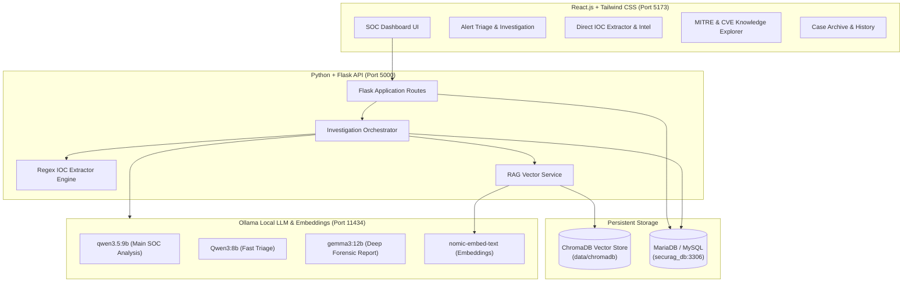

# SecuRAG AI 🛡️
### Local AI-Powered Cybersecurity Investigation Platform for SOC Analysts

SecuRAG AI is a local, privacy-first cybersecurity investigation platform designed for Tier-1 to Tier-3 SOC analysts and threat hunters. It combines **Retrieval-Augmented Generation (RAG)**, local **Ollama** large language models, a **ChromaDB** vector database, and **MariaDB / MySQL** persistent storage to analyze security alerts, Windows Sysmon/Security event logs, and technical indicators of compromise (IOCs).

---

## 🏛️ System Architecture



---

## 🛠️ Technology Stack

| Layer | Technology | Details |
|---|---|---|
| **Frontend** | React.js + Tailwind CSS | Vite, Lucide Icons, Cyberpunk Dark SOC Theme |
| **Backend** | Python 3.13 + Flask | Flask-CORS, SQLAlchemy, PyMySQL |
| **Vector DB (RAG)** | ChromaDB | Local persistent vector collection `cybersecurity_knowledge` |
| **Relational DB** | MariaDB 10.4 / MySQL | Database `securag_db`, tables for investigations & IOCs |
| **Embeddings** | `nomic-embed-text` | 768-dimensional local text embeddings via Ollama |
| **Main Analysis** | `qwen3.5:9b` | Tier-3 SOC analyst for threat triage, MITRE mapping & risk scoring |
| **Fast Triage** | `Qwen3:8b` | Rapid triage and immediate containment playbook |
| **Deep Reports** | `gemma3:12b` | Multi-stage attack chain forensics and executive debriefs |

---

## 🚀 Quick Start Guide

### Option 1: Unified One-Click Launcher (Windows)
Double-click:
```bat
start_securag.bat
```
This launcher checks MariaDB and Ollama, boots the Flask backend, launches the React frontend, and opens `http://localhost:5173` in your default browser.

---

### Option 2: Manual Step-by-Step

#### 1. Start MariaDB / MySQL (XAMPP)
Ensure MySQL is started in XAMPP on port `3306`.
The database `securag_db` is created automatically on first run.

#### 2. Start the Backend
```bash
cd backend
# Activate virtual environment
venv\Scripts\activate
# Start Flask server
python app.py
```
Backend API will be available at: `http://127.0.0.1:5000`

#### 3. Start the Frontend
```bash
cd frontend
# Start Vite development server
npm run dev
```
Frontend UI will be available at: `http://localhost:5173`

---

## 💡 Key Platform Capabilities

### 1. Alert Triage & RAG Investigation
- **Attack Scenario Presets:** Pre-loaded with realistic SOC incidents:
  - Ransomware & Volume Shadow Copy Deletion (`vssadmin`, `bcdedit`)
  - PowerShell Reverse Shell & LSASS Credential Dumping (`Mimikatz`)
  - Apache Log4j2 JNDI Remote Code Execution (`Log4Shell` / `CVE-2021-44228`)
  - Spearphishing with Macro & Ingress Tool Transfer (`certutil`)
  - Web Application SQL Injection & Schema Dumping
  - Active Directory Netlogon Takeover (`Zerologon` / `CVE-2020-1472`)
- **MITRE ATT&CK Matrix Mapping:** Direct attribution with Technique IDs (e.g., `T1059.001`, `T1486`), tactics, detection logic, and clickable links to official MITRE matrix.
- **Risk Score & Severity:** 0–100 calculated risk rating with severity badges (**CRITICAL**, **HIGH**, **MEDIUM**, **LOW**).
- **Interactive SOC Playbook:** Actionable containment and remediation checklist with checkboxes for incident responders.
- **Threat Hunting Queries:** Ready-to-use search syntax in **Microsoft KQL**, **Splunk SPL**, and **Sigma Rules** with 1-click copy.
- **Report Exporting:** Download full investigation reports in Markdown (`.md`) or print to PDF.

### 2. Direct IOC Extractor & Threat Intel Store
- High-precision regex engine extracts IPv4/v6, Domains, URLs, Hashes (MD5, SHA1, SHA256), CVEs, Registry Keys, and LOLBins from messy text logs.
- Automatic classification of private vs. public IPs.
- Synchronized with MariaDB threat intel tables for long-term historical search and deduplication.

### 3. MITRE ATT&CK, OWASP & CVE Knowledge Explorer (RAG)
- Semantic vector search powered by `nomic-embed-text` embeddings.
- Filter by **MITRE ATT&CK**, **OWASP Top 10**, or **CVE Knowledge**.
- Real-time similarity match scoring.
- Add custom organizational playbooks and detection rules directly into ChromaDB.

### 4. Persistent Investigation Archive
- Full case management stored in MariaDB (`securag_db`).
- Search and filter previous investigations by severity, model, or keywords.
- Instant 1-click reloading of historical cases into the triage workspace.

---

## 📁 Project Directory Structure

```text
SecuRAG/
│
├── start_securag.bat                 # Unified 1-click launcher
├── README.md                         # Platform documentation
│
├── backend/                          # Python Flask Backend
│   ├── app.py                        # Application entrypoint & CORS
│   ├── config.py                     # Environment configuration
│   ├── requirements.txt              # Python dependencies
│   ├── run.bat                       # Standalone backend launcher
│   ├── .env                          # Local credentials & model configs
│   ├── models/
│   │   └── database.py               # SQLAlchemy models (MariaDB)
│   ├── services/
│   │   ├── ollama_service.py         # Ollama LLM & Embeddings client
│   │   ├── rag_service.py            # ChromaDB vector retrieval & hybrid search
│   │   ├── knowledge_seed.py         # MITRE, OWASP & CVE seed dataset
│   │   ├── ioc_extractor.py          # High-precision IOC extraction engine
│   │   └── analyzer_service.py       # End-to-end investigation orchestrator
│   ├── routes/
│   │   ├── investigation_routes.py   # Investigation API endpoints
│   │   ├── ioc_routes.py             # IOC parsing & intelligence endpoints
│   │   ├── knowledge_routes.py       # Semantic RAG search endpoints
│   │   └── system_routes.py          # System telemetry & alert presets
│   └── data/
│       └── chromadb/                 # Persistent ChromaDB vector files
│
└── frontend/                         # React.js + Tailwind CSS Frontend
    ├── index.html                    # Web entry with Inter & JetBrains fonts
    ├── vite.config.js                # Vite config with backend proxy
    ├── tailwind.config.js            # SOC cyber theme palette configuration
    ├── run.bat                       # Standalone frontend launcher
    └── src/
        ├── api.js                    # API client wrapper
        ├── App.jsx                   # Main application layout & state
        ├── index.css                 # Base Tailwind directives & cyber glows
        ├── main.jsx                  # React DOM mount point
        └── components/
            ├── Header.jsx            # Top navbar, live telemetry & model selector
            ├── InvestigationView.jsx # Live triage, MITRE cards, IOCs & playbooks
            ├── IOCScannerView.jsx    # Quick artifact extractor & threat table
            ├── KnowledgeExplorerView.jsx # Vector RAG semantic search & rules
            └── HistoryView.jsx       # MariaDB investigation case archive
```

---

## 🔒 Security & Privacy Notice
SecuRAG AI processes all telemetry, log files, and indicators **100% locally**. No security events or alert contents are transmitted to external third-party cloud APIs.
